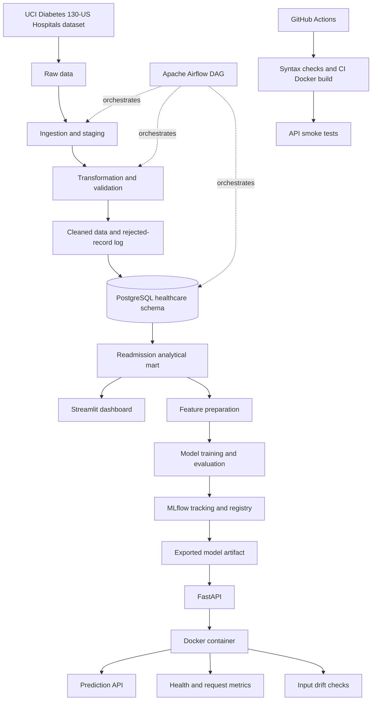

# Hospital Readmission Analytics & MLOps

An end-to-end data engineering and machine-learning project for
analysing 30-day hospital readmissions using the **Diabetes 130-US
Hospitals (1999--2008)** dataset. The project combines an orchestrated
ETL pipeline, PostgreSQL analytics, a Streamlit dashboard, model
training and tracking, a FastAPI prediction service, Docker packaging,
and GitHub Actions CI.

> **Research and education only.** This is an academic prototype, not a
> clinically validated tool. Its predictions must not be used to make
> patient-care decisions.

[](https://github.com/ykr1910/Hospital-Readmission-Analytics/actions/workflows/ci.yml)


## Overview

The project has two connected areas:

-   **Data engineering and analytics:** ingest and stage source data,
    validate and transform records, engineer features, load PostgreSQL
    tables, orchestrate ETL with Apache Airflow, and explore results in
    Streamlit.
-   **Machine learning and serving:** compare classification models,
    track experiments with MLflow, serve predictions through FastAPI,
    package the service with Docker, and expose health, request metrics,
    and input-drift checks.

### Key capabilities

-   Layered raw, staging, and cleaned data workflow.
-   Validation rules and rejected-record logging.
-   PostgreSQL analytical tables and readmission data mart.
-   Airflow orchestration of ingestion, transformation, and database
    loading.
-   Streamlit dashboard with readmission analysis and CSV export.
-   Patient-group-aware train/validation/test split to reduce leakage
    between sets.
-   Logistic Regression, Random Forest, and XGBoost model comparison.
-   MLflow experiment tracking and model registry integration.
-   FastAPI prediction, health, metrics, and drift endpoints.
-   Dockerized API and GitHub Actions checks for syntax, image build,
    API health, and prediction smoke tests.

## Architecture



The CI Docker image uses a **dummy test model** to verify API startup
and endpoint behavior without requiring local model artifacts. It is not
the model used for real predictions. The production Docker image
requires the actual model and reference-data artifacts generated or
exported during the local workflow.

## Dataset

**Diabetes 130-US Hospitals for Years 1999--2008**

-   Source: [UCI Machine Learning
    Repository](https://archive.ics.uci.edu/dataset/296/diabetes+130+us+hospitals+for+years+1999+2008)
-   Dataset ID: `296`
-   DOI: [10.24432/C5230J](https://doi.org/10.24432/C5230J)
-   License: CC BY 4.0
-   Size: 101,766 hospital encounters across 130 US hospitals/integrated
    delivery networks.
-   Target: readmission within 30 days, derived from `readmitted` (`<30`
    indicates readmission within 30 days).

The source data is de-identified. This project is for analytics and
educational experimentation, not clinical decision-making.

## Technology stack

  Area                               Tools
  ---------------------------------- -----------------------------
  Programming and data processing    Python, Pandas
  ETL and validation                 Python scripts, SQLAlchemy
  Database                           PostgreSQL, Psycopg2
  Workflow orchestration             Apache Airflow (WSL Ubuntu)
  Dashboard and visualization        Streamlit, Plotly
  Machine learning                   scikit-learn, XGBoost
  Experiment tracking and registry   MLflow
  Prediction service                 FastAPI, Uvicorn
  Packaging                          Docker
  CI                                 GitHub Actions

## Repository layout

``` text
Hospital-Readmission-Analytics/
├── api/
│   └── main.py
├── dashboard/
│   └── app.py
├── scripts/
│   ├── ingest.py
│   ├── transform.py
│   ├── load_database.py
│   └── train_models.py
├── models/
│   ├── decision_threshold.json
│   └── deployment_manifest.json
├── .github/
│   └── workflows/
│       └── ci.yml
├── Dockerfile
├── Dockerfile.ci
├── .dockerignore
├── requirements.txt
├── requirements-api.txt
└── README.md
```

Datasets, logs, reports, trained model binaries, MLflow tracking data,
and credentials are intentionally excluded from Git. Some files are
generated locally and may not exist in a fresh clone. The Airflow DAG is
configured in the local Airflow DAG directory in WSL.

## Data engineering workflow

The ETL workflow runs in this order:

``` text
ingest_data
    ↓
transform_and_validate
    ↓
load_postgresql
```

### 1. Ingest

The ingestion step reads the source CSV, preserves the raw data, creates
a staging copy, and records ingestion metadata.

### 2. Transform and validate

The transformation step validates required fields, duplicate encounter
IDs, length of stay, diagnosis counts, and readmission status. It
handles selected missing values, engineers analytical features, and
records rejected records.

Key engineered features:

-   `patient_key`: surrogate patient identifier for analysis.
-   `prior_visits`: prior inpatient, emergency, and outpatient
    utilization count as defined by the pipeline.
-   `diagnosis_count`: count of available diagnosis fields.
-   `medication_count`: count based on medication activity fields.
-   `age_group`: grouped age category.

### 3. Load PostgreSQL

The loading step populates the `healthcare` schema.

  -----------------------------------------------------------------------------------
  Table                           Purpose                     Previously observed row
                                                                                count
  ------------------------------- ---------------------- ----------------------------
  `healthcare.admissions`         Encounter and                               101,766
                                  hospital-utilization
                                  data

  `healthcare.diagnoses`          Encounter diagnosis                         101,766
                                  fields

  `healthcare.patient_summary`    Patient-level summary                        71,518
                                  and history

  `healthcare.readmission_mart`   Dashboard-ready                             101,766
                                  analytical dataset
  -----------------------------------------------------------------------------------

These counts describe the current project dataset and may vary if the
source or transformation logic changes.

## Dashboard

Start the Streamlit dashboard from the project root:

``` powershell
.\venv\Scripts\Activate.ps1
streamlit run dashboard/app.py
```

Open <http://localhost:8501>.

The dashboard includes:

-   Overall 30-day readmission rate and encounter counts.
-   Readmission rates by age group and gender.
-   Length of stay, prior visits, diagnosis count, and medical specialty
    analysis.
-   Readmission status and primary diagnosis views.
-   Dataset summary and data-quality indicators.
-   CSV export of analytical data.

Previously observed dataset-level figures:

  Metric                                Value
  --------------------------------- ---------
  Total encounters                    101,766
  Unique patients                      71,518
  Readmissions within 30 days          11,357
  Overall 30-day readmission rate      11.16%

These are descriptive statistics for this dataset, not population-level
clinical estimates.

## Machine-learning workflow

The modelling workflow uses engineered features including age group,
gender, admission type, time in hospital, prior visits, diagnosis count,
medication count, and medical specialty.

The training workflow compares Logistic Regression, Random Forest, and
XGBoost. A patient-group-aware split reduces leakage between training,
validation, and test sets. The decision threshold is selected using
validation data; final metrics are evaluated on the held-out test set.

### Current recorded test metrics

  Metric                  Value
  -------------------- --------
  ROC-AUC                0.6311
  Precision              0.1661
  Recall                 0.4211
  F1 score               0.2383
  Brier score            0.0914
  Decision threshold     0.1336

The current XGBoost model offers modest discrimination and low
precision. A positive prediction is not a diagnosis, and a negative
prediction does not rule out readmission. Model performance,
calibration, subgroup behavior, data quality, and external validity
would need further evaluation before any clinical use.

## Prediction API

The FastAPI service is packaged as a Docker container and serves the
exported model artifact.

When the API container is running, its base URL is
`http://localhost:8000`. Interactive documentation is available at
<http://localhost:8000/docs>.

  -----------------------------------------------------------------------
  Endpoint                            Purpose
  ----------------------------------- -----------------------------------
  `GET /health`                       Service and deployed-model metadata

  `POST /predict`                     Return a readmission probability
                                      and threshold-based class

  `GET /metrics`                      Aggregate request counts, failures,
                                      error rate, and latency

  `GET /drift`                        Compare recent prediction inputs
                                      with reference features
  -----------------------------------------------------------------------

### Example prediction request

``` json
{
  "age_group": "70-80",
  "gender": "Female",
  "admission_type_id": 1,
  "time_in_hospital": 3,
  "prior_visits": 0,
  "diagnosis_count": 5,
  "medication_count": 10,
  "medical_specialty": "InternalMedicine"
}
```

The response includes the predicted class, probability, configured
threshold, model name, and an academic-prototype notice. Exact values
depend on the deployed model artifact.

### Monitoring notes

-   `/metrics` reports aggregate request and latency information.
-   `/drift` requires at least 30 successful prediction samples before
    interpreting feature-level drift.
-   Numeric distribution shifts use Population Stability Index (PSI);
    categorical shifts use total variation distance.
-   Drift indicates a change in input distributions, not whether
    prediction accuracy has changed.

## Run the API with Docker

The production `Dockerfile` expects the actual model artifact and
reference features to exist locally. These generated artifacts are
excluded from Git, so a fresh clone must first reproduce or export them
using the project workflow.

Build the production image only after the required artifacts are
available:

``` powershell
docker build -t hospital-readmission-api:local .
docker run --name hospital-readmission-api -p 8000:8000 hospital-readmission-api:local
```

If a container already uses port `8000`, inspect it before starting
another one. Do not use `Dockerfile.ci` for real predictions: it creates
a dummy model solely for automated testing.

## Configuration and secrets

-   Keep database credentials and local settings in `.env`.
-   Never commit `.env`, database passwords, API keys, or other secrets.
-   Configure database connection values for your environment.
-   The dashboard connects to the local PostgreSQL service; Airflow runs
    separately in WSL Ubuntu.
-   Review `.gitignore` before adding generated datasets, model
    binaries, logs, or tracking databases to Git.

Example configuration shape (use your own local values):

``` dotenv
DB_HOST=localhost
DB_PORT=5432
DB_NAME=hospital_readmission
DB_USER=postgres
DB_PASSWORD=replace_with_your_local_password
```

Do not copy real credentials into this README or commit them to version
control.

## Continuous integration

GitHub Actions runs on pushes and pull requests targeting `main`. The
workflow:

1.  Checks Python syntax.
2.  Builds the CI-only Docker image.
3.  Starts the API container.
4.  Tests `/health`.
5.  Sends a sample request to `/predict` and validates the response.
6.  Prints container logs on failure and removes the test container.

The CI workflow verifies basic startup and endpoint behavior. Since it
uses a dummy classifier, it does not evaluate the trained XGBoost
model's quality or replace testing with real model artifacts.

## Reproducibility

The project uses separate environments for the Windows ETL/dashboard
workflow and Airflow in WSL Ubuntu.

Typical ETL commands, run from the repository root:

``` powershell
.\venv\Scripts\Activate.ps1
python scripts/ingest.py
python scripts/transform.py
python scripts/load_database.py
streamlit run dashboard/app.py
```

To train or compare models, run the training script after installing its
dependencies and ensuring the processed data is available:

``` powershell
python scripts/train_models.py
```

Airflow runs in WSL Ubuntu. Activate the configured Airflow virtual
environment and trigger the `hospital_readmission_etl` DAG through the
Airflow UI. Local paths and environment settings may need to be adapted
on another machine.

## Privacy, limitations, and responsible use

-   The source dataset is de-identified and publicly available.
-   Keep credentials and generated local artifacts out of source
    control.
-   A surrogate patient key is used instead of exposing the source
    patient identifier directly in analytical tables.
-   Aggregate dashboard results should not be interpreted as causal
    relationships.
-   This project is an academic prototype, has not been clinically
    validated, and must not be used for real patient-care decisions.

## References

-   [UCI Machine Learning Repository --- Diabetes 130-US Hospitals for
    Years
    1999--2008](https://archive.ics.uci.edu/dataset/296/diabetes+130+us+hospitals+for+years+1999+2008)
-   [Dataset DOI: 10.24432/C5230J](https://doi.org/10.24432/C5230J)
-   [Apache Airflow documentation](https://airflow.apache.org/docs/)
-   [PostgreSQL documentation](https://www.postgresql.org/docs/)
-   [Streamlit documentation](https://docs.streamlit.io/)
-   [MLflow documentation](https://mlflow.org/docs/latest/)
-   [FastAPI documentation](https://fastapi.tiangolo.com/)
-   [Docker documentation](https://docs.docker.com/)
